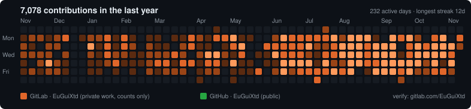

# forge-bridge

**Your real work, on your profile, without leaking a line of it.**

Most of what many developers ship lives in private company repositories on GitLab. Their GitHub
profile shows an empty contribution graph, and their GitLab profile shows nothing at all.
`forge-bridge` merges both into one contribution card for your profile README, using only data each
platform already makes public, so anyone can verify it at the source.

<picture>
  <source media="(prefers-color-scheme: light)" srcset="out/heatmap-light.svg">
  
</picture>

## How it works

| Source | What is read | Auth |
|---|---|---|
| GitLab | `/users/<you>/calendar.json` — contribution **counts per day** | none |
| GitHub | `contributionsCollection` calendar via GraphQL | any token (the Actions `GITHUB_TOKEN` works) |

It never touches repositories, code, project names, commit messages or merge requests. GitLab only
includes private-project activity in that calendar when **you** opt in (*Edit profile → Include
private contributions on my profile*), and even then it publishes counts, nothing else.

Output, all self-contained SVG (no third-party image service, so nothing breaks or gets rate-limited):

- `out/heatmap-dark.svg` / `out/heatmap-light.svg` — 53-week grid, each day colored by its dominant
  source (GitLab orange, GitHub green), intensity by combined total
- `out/terminal.svg` — an animated terminal card with your impact lines and live stats
- `out/stats.json` — totals, active days, streaks, busiest month

## Why it's verifiable

Every number on the card links back to a calendar the platforms render themselves. The heatmap
footer points to your GitLab profile, where GitLab shows the same daily counts. Nothing is
backdated or synthesized into GitHub's own graph — that would be faking evidence, and reviewers
notice.

## Usage

```bash
# Node 20+, zero dependencies
cp forge-bridge.config.json my.config.json   # edit users + terminal lines
GITHUB_TOKEN=$(gh auth token) node src/cli.js my.config.json
npm test
```

Run it daily from your profile repository with the workflow in
[`examples/update-profile.yml`](examples/update-profile.yml).

## Limits

- GitLab's public calendar covers the last 12 months only.
- Counts follow GitLab's definition of a contribution (pushes, MRs, issues, comments), not commits.
- Self-managed GitLab works too (`gitlab.baseUrl`), as long as the calendar endpoint is reachable.

## License

MIT
